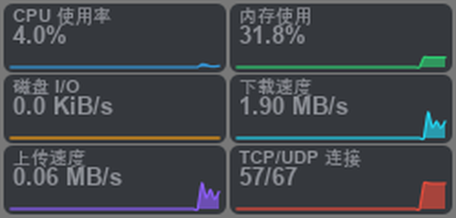
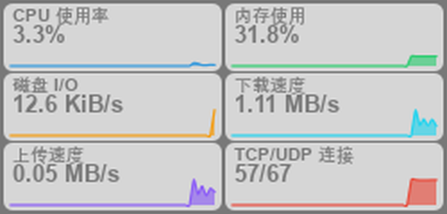
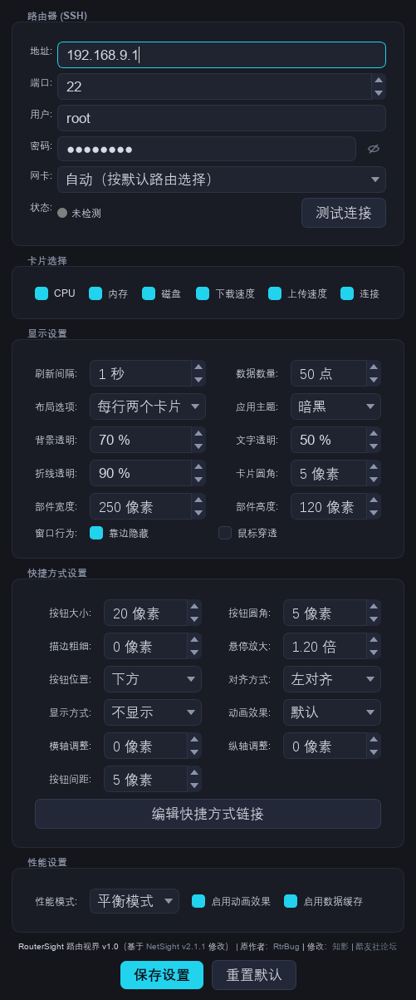
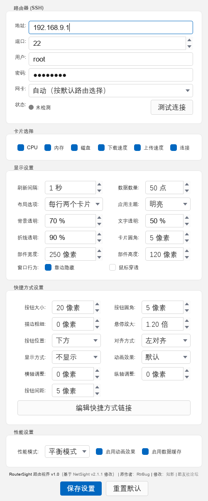

# RouterSight · 路由视界

面向 Windows 桌面的轻量级路由器监控组件，**无需部署 Netdata**。

组件通过 **SSH 直读 iStoreOS / OpenWrt 的 `/proc`** 采集指标，在桌面实时呈现 CPU 使用率、内存占用、磁盘 I/O、**下载 / 上传速率**与 TCP/UDP 连接数。

> 原版 NetSight 依赖路由器安装 iStoreOS 应用商店中的「NetData 系统监控」；本项目改为自行采集，路由器端**无需安装、无常驻进程**。

---

## 下载

| 文件 | 平台 | 说明 |
|---|---|---|
| [**RouterSight-1.1-x86_64.AppImage**](https://github.com/lhflowersbloom/RouterSight/releases/download/v1.1/RouterSight-1.1-x86_64.AppImage) | Linux x86_64 | 单文件 AppImage，`chmod +x` 后双击或命令行运行 |
| [**RouterSight-1.0-single.exe**](https://github.com/lhflowersbloom/RouterSight/releases/download/v1.0/RouterSight-1.0-single.exe) | Windows | 单文件版，下载后双击即用（首次启动稍慢） |
| [**RouterSight-1.0-portable.zip**](https://github.com/lhflowersbloom/RouterSight/releases/download/v1.0/RouterSight-1.0-portable.zip) | Windows | 文件夹版，解压后运行 `RouterSight\RouterSight.exe`（启动更快，推荐） |

同一平台的两个文件功能完全相同，任选其一即可。**附件内不含配置文件**，首次运行会在程序同目录自动生成 `RouterSight_config.ini`。

Linux 版需要 glibc ≥ 2.17，构建与排错见 [linux/README-linux.md](linux/README-linux.md)；版本变更见 [CHANGELOG.md](CHANGELOG.md)。

全部版本见 [Releases](https://github.com/lhflowersbloom/RouterSight/releases)。

---

## 来源与致谢

| | |
|---|---|
| **改自** | [**酷友社论坛**](https://www.koolcenter.com/) 的 **NetSight v2.1.1**（原作者 **RtrBug**，原帖：<https://www.koolcenter.com/t/topic/7826>） |
| **反编译与重构** | **经 DeepSeek 优化**完成 —— 从 PyInstaller 打包的 exe 中还原出 Python 源码，改为 SSH 直读路由器，修正局域网测速翻倍的缺陷，并重做整套界面 |
| **界面 / 交互** | 知影 |

原程序通过 REA 工具链从 `NetSight.exe`（PyInstaller + Python 3.13）提取并反编译，随后在其基础上对界面、数据层与打包脚本做了完整重写。原作者的署名与版权归 RtrBug 所有；本仓库仅作学习与个人使用。

---

## 截图

| 桌面组件（暗黑） | 桌面组件（明亮） |
|---|---|
|  |  |

| 设置窗口（暗黑） | 设置窗口（明亮） |
|---|---|
|  |  |

托盘菜单：


图标（16px 起可用）：


---

## 功能

- **六张卡片**：CPU 使用率 · 内存使用 · 磁盘 I/O · 下载速率 · 上传速率 · TCP/UDP 连接数
- **速率单位为 MB/s**，下载（青）/ 上传（紫）分别显示，不做相加
- **靠边隐藏**：拖至屏幕边缘自动停靠，鼠标移开后 0.5 秒仅在屏幕内保留 **4px**；鼠标移至该边缘即自动滑出
- **鼠标穿透**：启用后组件忽略鼠标事件，不影响桌面其他操作；仅可通过托盘菜单关闭（避免启用后无法操作组件自身）
- **双主题**：暗黑 / 明亮。明亮主题遵循 **Windows 11 (WinUI) 规范**配色（`#F3F3F3` 底 / `#FFFFFF` 卡片 / `#E5E5E5` 描边 / `#0067C0` 主色），字体依次为 Segoe UI → 微软雅黑
- 多显示器：停靠与穿透均按**光标所在屏幕**判定，并使用工作区（不遮挡任务栏）
- 开机自启、窗口置顶、快捷方式按钮、无边框拖拽、托盘菜单
- **密码框可见性切换**：设置窗口中密码默认掩码显示，点击右侧眼睛图标可临时查看明文
- 连接失败自动退避（2 → 4 → 8 → 16 → 30 秒封顶），并保证失败连接的 SSH 套接字立即释放，不会占满路由器的 SSH 会话
- `--selftest` 命令行自检，便于快速定位问题

---

## 为什么不再需要 Netdata

原版每 1 秒请求一次 `http://<路由器>:19999/api/v1/allmetrics?format=json`，取 `system.net` 的 `InOctets`/`OutOctets` 相加。

问题在于 **Netdata 的 `system.net` 为所有网卡的汇总值**：一次外网下载会同时计入 `eth0.rx`、`eth1.tx`、`br-lan.tx`，相加后自然成倍放大。

实测（从路由器拉取 500MB 数据期间采样）：

| 统计方式 | 读数 |
|---|---|
| `eth1` 单网卡上传 | **464,549 kb/s** ← 真实值 |
| 原版「全接口 in + out」 | **928,501 kb/s** = 恰好 2.0 倍 |

当前实现：**只统计用户指定的单个网卡，且下载 / 上传分别计算**，从结构上排除翻倍。

---

## 工作原理

```
┌─────────────── Windows ───────────────┐        ┌──────── iStoreOS / OpenWrt ────────┐
│  RouterSight.exe (PyQt5)              │  SSH   │  sshd                              │
│   ├─ RouterStats ──── paramiko ───────┼───────▶│  sh -s  ← 只读脚本从 stdin 进入     │
│   │    采样 2 次算差分 → CPU%/速率     │  :22   │   ├─ /proc/stat      CPU          │
│   ├─ 6 张卡片 (QPainter 自绘)          │        │   ├─ /proc/meminfo   内存         │
│   └─ 靠边隐藏 / 鼠标穿透 (Win32 API)   │        │   ├─ /proc/net/dev   各网卡字节数 │
└───────────────────────────────────────┘        │   ├─ /sys/block + /proc/diskstats │
                                                  │   └─ /proc/net/{tcp,udp}*  连接数 │
                                                  └───────────────────────────────────┘
```

- 路由器上**不留任何文件**：脚本以 `sh -s` 从标准输入注入，纯 `busybox` 兼容语法，只读不写
- 维持单个长连接（keepalive 15s），每 `refresh_interval` 秒执行一次采样
- CPU% 与速率均为**两次采样的差分值**，因此首次读数会滞后一个采样周期
- 支持 SSH key 免密登录，也支持密码认证

---

## 快速开始

1. 从 [Releases](https://github.com/lhflowersbloom/RouterSight/releases) 下载 `RouterSight-1.0-single.exe`，或下载 `RouterSight-1.0-portable.zip` 后解压
2. 双击运行后，托盘出现图标，桌面显示组件
3. 托盘右键 → **设置**，填写：

   | 项 | 说明 |
   |---|---|
   | 地址 | 路由器 IP，如 `192.168.9.1` |
   | 端口 | SSH 端口，默认 `22` |
   | 用户 | 一般为 `root` |
   | 密码 | 路由器 root 密码（也可留空改用 SSH key） |
   | 网卡 | `自动（按默认路由选择）` = 走 WAN 口；如需统计局域网流量，请选择 `br-lan` / `eth1` |

4. 点击 **测试连接**，返回「正常」即表示连通
5. 在「显示设置 → 窗口行为」中勾选 **靠边隐藏**；如需组件完全不影响桌面操作，可从托盘菜单开启 **鼠标穿透**

> 配置文件 `RouterSight_config.ini` 与 exe 同目录，保存时会自动保留一份 `.bak`。
> 从旧版 NetSight 升级会自动复制 `NetSight_config.ini` → `RouterSight_config.ini`。

---

## 托盘菜单

```
鼠标穿透     ← 勾选后组件忽略鼠标事件，仅可在此处取消
置顶
开机启动
设置
退出
```

原版包含「显示/隐藏」与「锁定/解锁」两项，本版**已移除**：靠边隐藏已取代手动隐藏，穿透状态由托盘独占控制，避免启用穿透后无法操作组件自身。

---

## 从源码运行 / 构建

```bash
# 依赖
pip install PyQt5==5.15.11 paramiko cryptography

# 直接运行
python RouterSight.py

# 自检（连接、采样、字段完整性）
python RouterSight.py --selftest

# 打包（--onefile / --onedir，默认两者都打）
python build.py
```

打包产物：

- `dist/RouterSight.exe` —— 单文件版（约 46 MB）
- `dirdist/RouterSight_dir/` —— 文件夹版（启动更快，推荐）

辅助脚本：

| 文件 | 用途 |
|---|---|
| `routersight_router.py` | SSH 数据层：`RouterStats`、`to_netdata_metrics`、`test_connection` |
| `make_icon.py` | 生成黑白图标（`assets/logo.png`、`assets/logo.ico` 及箭头 PNG） |
| `ui_preview.py` | 离屏渲染设置窗口（暗 / 亮两套）为 PNG |
| `render_widget.py` | 离屏渲染桌面组件为 PNG |
| `menu_preview.py` | 离屏渲染托盘菜单为 PNG |
| `smoke_test.py` | 无界面冒烟测试：实际采样并输出各卡片的显示文本 |
| `edge_test.py` | 靠边隐藏与鼠标穿透的单元测试（使用 `WA_DontShowOnScreen`，不干扰桌面） |
| `leak_test.py` | 回归测试：连续用错误密码连接，校验失败连接不残留套接字 |
| `recover_test.py` | 回归测试：错误密码反复尝试后，正确密码仍可正常连接 |
| `health_check.py` | 单次连接健康检查（供上述测试脚本调用） |
| `eye_preview.py` | 离屏渲染密码框「小眼睛」的两种状态 |
| `lan_test.py` | 对比脚本：复现并验证「局域网传输测速翻倍」问题 |

> 离屏渲染需要 `QT_QPA_PLATFORM=offscreen` 与 `QT_QPA_FONTDIR=C:\Windows\Fonts`，否则文字为空白。

---

## 配置项速查

| 键 | 默认 | 说明 |
|---|---|---|
| `router_host` / `router_port` / `router_user` / `router_password` | `192.168.100.1` / `22` / `root` / 空 | SSH 连接 |
| `router_key` | 空 | 私钥路径，填写后改用 key 登录 |
| `net_interface` | `auto` | `auto` = 默认路由网卡；或指定 `eth0` `br-lan` … |
| `refresh_interval` | `1` | 刷新秒数 |
| `data_points` | `50` | 曲线保留点数 |
| `layout_option` | `2` | 1 单行 / 2 每行两个 / 4 紧凑 |
| `theme` | `1` | 0 明亮 / 1 暗黑 |
| `card_opacity` `text_opacity` `chart_opacity` `card_radius` | `70` `50` `90` `5` | 外观 |
| `edge_hide` | `True` | 靠边隐藏 |
| `click_through` | `False` | 鼠标穿透 |
| `show_cpu_chart` … `show_connections_chart` | `True` | 六张卡片开关 |
| `widget_x` `widget_y` `widget_width` `widget_height` `widget_stays_on_top` | — | 位置与置顶 |

---

## 常见问题

**Q：状态一直显示「离线」？**
请先在设置中执行「测试连接」。若 SSH 无法连接，请依次检查：路由器 sshd 是否启用、端口是否被修改、密码是否正确、Windows 防火墙是否放行出站 22。

**Q：CPU / 速率首秒为 0？**
属正常现象：差分指标需要两次采样，第二次采样后才有值。

**Q：数据明显异常 / 速率偶尔翻倍？**
通常为网卡选择有误。`自动` 采用默认路由网卡（一般为 WAN 口 `eth0`）。如需在**局域网内部传输**时获得准确速率，请选择实际承载流量的网卡（`br-lan` 或 `eth1`）—— 单网卡、分方向统计不会出现翻倍。

**Q：启用穿透后无法操作组件？**
此为设计行为：请在**托盘图标**上右键 → 取消勾选「鼠标穿透」。

**Q：状态提示「路由器未响应 SSH 握手（连接数已满或被限流）」？**
路由器（dropbear）能同时接受的**未认证** SSH 连接数很小。旧版本在连接失败时不释放套接字，反复重试会把它占满，之后即使密码正确也无法连接。当前版本已在失败时立即关闭连接并加入退避重试，正常不会再出现；若出现，等待约 30 秒即可恢复。可用 `python leak_test.py` 复现并验证（连续失败后残留连接应为 0）。

**Q：如何排查启动问题？**
在命令行执行 `RouterSight.exe --selftest`，会在 exe 同目录生成 `RouterSight_selftest.txt`，内含连接结果、各项指标与错误信息。

---

## 已知限制

- 仅在 **iStoreOS 24.10（OpenWrt 系）** 上实测；其他发行版只要具备 `busybox` 与标准 `/proc` 布局即可运行，但未经验证
- 仅支持 **Windows 10/11 x64**
- 路由器密码以**明文**保存在 `RouterSight_config.ini`（继承自原版设计）。如需规避，请改用 SSH key：`router_key` 填写私钥路径、密码留空
- 曲线为单线条自绘，无历史持久化，重启后清空
- 内存曲线上限固定按物理内存计算，不随采样缩放

## 安全提示

程序仅读取 `/proc`，不写入路由器、不修改配置、不开放端口。
但请注意：**路由器已在局域网内暴露 SSH(22)、LuCI(80/443)、AdGuardHome(3000)、ttyd(7681) 等端口**。ttyd 为网页终端，一旦可登录即等同于交出 root 权限。建议关闭不需要的服务或限制访问来源。

---

## 免责声明

本项目为个人学习用途的二次开发，与原程序作者 RtrBug 及酷友社论坛无隶属关系。
使用前请自行确认所在网络环境的合规性；因使用本程序造成的任何后果由使用者自行承担。

## 许可

原程序版权归 **RtrBug / 酷友社论坛** 所有。本仓库的修改部分可自由使用、修改、分发；转载请注明原出处与本仓库。
